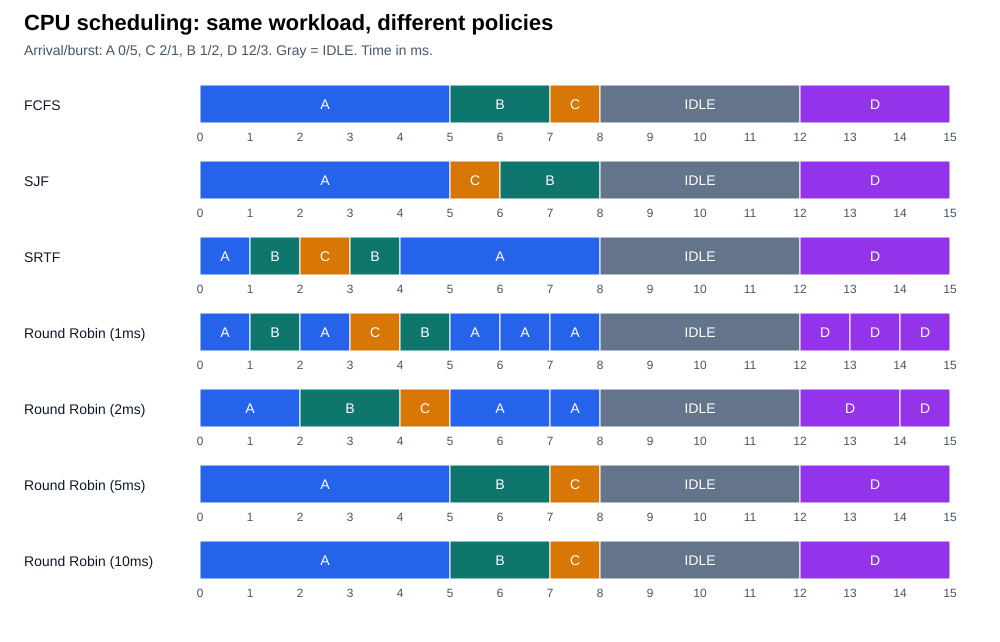

# CPU Scheduling Simulator

A Java console project for exploring how CPU scheduling policies affect waiting and turnaround time. Enter processes interactively or load a workload file, then compare FCFS, SJF, SRTF, and Round Robin using per-process statistics and Gantt charts.



## Scheduling policies

| Algorithm | How it chooses the next process |
| --- | --- |
| FCFS | Arrival order; each process runs to completion. |
| SJF | Shortest burst among ready processes, without preemption. |
| SRTF | Shortest remaining burst, reconsidered at arrivals and completions. |
| Round Robin | FIFO ready queue with a configurable time quantum. |

FCFS breaks arrival ties by input order. SJF and SRTF break equal-burst or equal-remaining-time ties by input order. Round Robin admits arrivals through the end of a slice before requeuing the current process. Idle gaps appear explicitly in each timeline.

## Example results

The [comparison workload](workloads/comparison.txt) has four processes, including out-of-order arrivals and an idle gap. All times below are simulated milliseconds.

| Algorithm | Average waiting | Average turnaround |
| --- | ---: | ---: |
| FCFS | 2.250 | 5.000 |
| SJF | 2.000 | 4.750 |
| SRTF | 1.000 | 3.750 |
| Round Robin, q=1 | 1.500 | 4.250 |
| Round Robin, q=2 | 1.500 | 4.250 |
| Round Robin, q=5 or 10 | 2.250 | 5.000 |

These results illustrate this workload, rather than a general ranking. See the [full example](docs/example.md) for per-process tables and text timelines. Waiting time is turnaround minus burst; turnaround is completion minus arrival.

## Run

Requires **JDK 17+**, with `java` and `javac` available. There are no external dependencies. From the repository root in PowerShell:

```powershell
.\build.ps1 test
.\build.ps1 run
.\build.ps1 run -Workload workloads/comparison.txt -Quanta 1,2,5,10
.\build.ps1 report
```

If needed, add `-JavaHome '<jdk-directory>'`. On a POSIX shell:

```sh
sh build.sh test
sh build.sh run
sh build.sh run workloads/comparison.txt 1 2 5 10
sh build.sh report
```

Interactive mode prompts for each process's ID, arrival, and burst. Workload files use one `ID arrival burst` triple per line; blank lines and `#` comments are allowed. Times are integers, arrivals must be nonnegative, and bursts/quanta must be positive. IDs must be unique letters, digits, underscores, or hyphens; `IDLE` is reserved. Round Robin defaults to quanta 5 and 10.

## Tests and project layout

The saved test run passed **23/23 regressions** and **1,400 seeded reference comparisons** across 200 workloads, plus 41 invalid-input and eight large-time checks. Run `test` to reproduce them; see [testing notes](docs/TESTING.md).

- `src/`: process model, scheduling engine, and console interface.
- `tests/`: dependency-free Java regression and reference tests.
- `workloads/`: comparison, tie, and long-burst examples.
- `tools/GenerateReport.java`: regenerates the example tables and SVG from scheduler results.
- `baseline/`: original sources for comparing behavior before fixes; excluded from normal builds.

The model assumes one CPU, one known burst per process, and no I/O or context-switch cost. Very small Round Robin quanta can produce large timelines.

## Credits

Based on my October 2025 scheduling program (Logan McKinney). Later Codex-assisted revisions added scheduler fixes, reference tests, and reproducible reports. No reuse license has been selected; coursework sharing permission has not been documented here.
